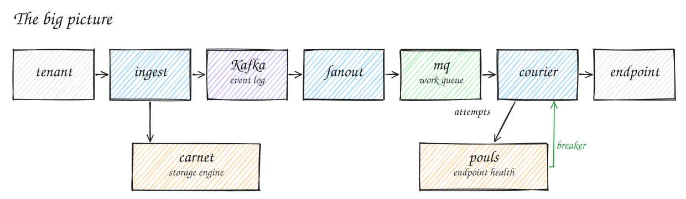
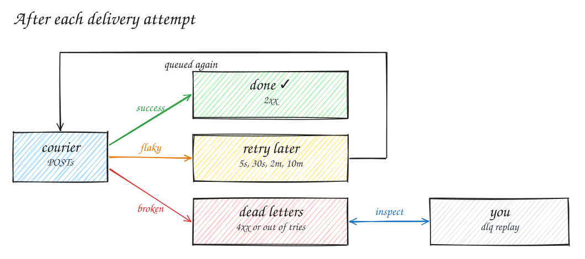
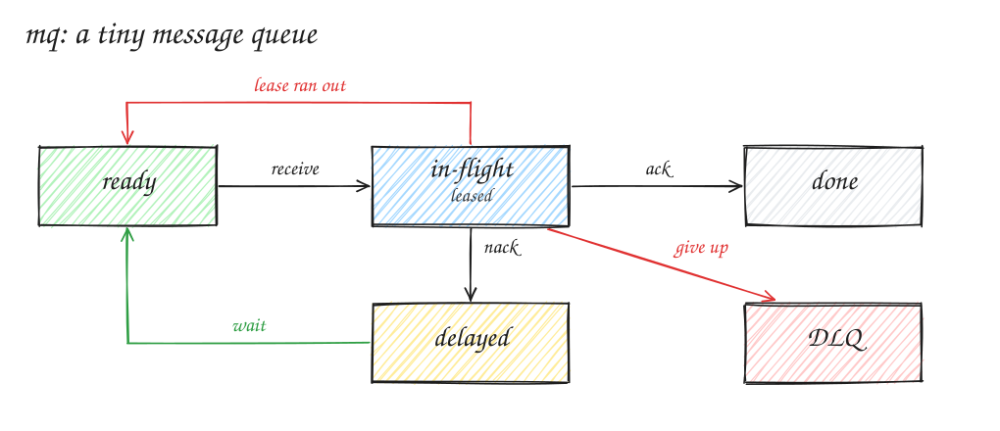
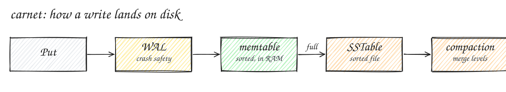
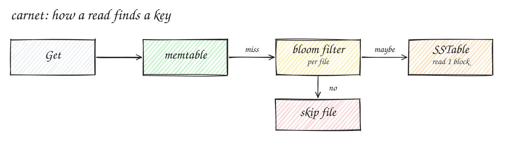
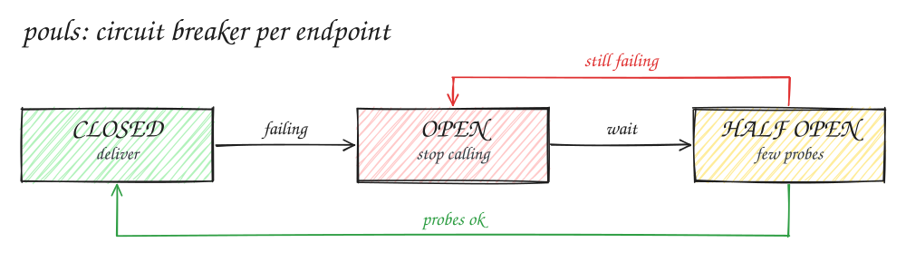
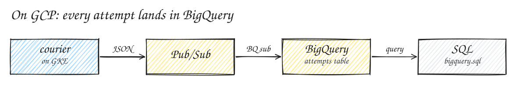

# Martinet

I read *Designing Data-Intensive Applications* and wanted to see the ideas work, not just read about them. Martinet is the playground I built for that: a webhook delivery system where the interesting parts are written from scratch so you can open them up, break them, and watch what happens.

*Martinet* is French for the swift, a bird that almost never lands.

**What it does:** an app publishes an event like `order.created`. Martinet delivers it to every URL that subscribed. If a URL is down, Martinet retries later. If it stays broken, the delivery goes to a dead letter queue, where you can look at it and replay it.



## What I built to learn

| Piece | The idea it taught me |
|---|---|
| **carnet** (C++) | How databases actually store data: a log-structured merge-tree with a write-ahead log, sorted files, bloom filters and compaction |
| **mq** (Go) | How a message queue works inside: leases, retries with delays, and a dead letter queue |
| **pouls** (C++) | Stream processing: counting failures in time windows, even when events arrive late |
| **the services** (Go) | Idempotency, "at-least-once" delivery, and keeping a log as the source of truth |

## Experiment 1: retries and dead letters



Every delivery ends in one of three places:

- **Success:** the job is done.
- **A flaky failure** (a 5xx or a timeout): it waits and tries again, after 5s, then 30s, 2m and 10m.
- **A real failure** (a 4xx, or out of tries): it goes to the dead letter queue.

Try it:

```bash
martinetctl subscribe -tenant acme -url 'http://sink:8088/flaky?p=0.6'   # fails 60% of the time
martinetctl subscribe -tenant acme -url http://sink:8088/gone            # always 410
martinetctl publish   -tenant acme -type order.created -data '{"order":7}'
martinetctl event <event_id>       # watch the retries happen
martinetctl dlq list               # the 410 is sitting here
martinetctl dlq replay -sub <id>   # send it back for another go
```

## Experiment 2: a message queue from scratch



`mq` is about 300 lines ([`internal/mq/broker.go`](internal/mq/broker.go)). The trick that makes it reliable is the **lease**:

1. A worker takes a message and has a deadline to finish it.
2. If the worker crashes, the deadline passes and the message becomes visible again for another worker.
3. Nothing gets lost, but a message can be delivered twice.

That trade-off is called *at-least-once* delivery, and it's why every webhook carries a delivery ID receivers can use to spot duplicates.

Things worth poking at:
- kill a courier mid-delivery and watch the message come back;
- set `MQ_MAX_RECEIVES=2` and see poison messages end up in the DLQ.

## Experiment 3: a storage engine from scratch

**Writes** are fast because nothing is ever overwritten in place:



**Reads** are fast because most files can be skipped without touching the disk:



Numbers from my laptop (`make bench`, 200k keys):

| | ops/sec |
|---|---|
| writes | 103k |
| reads | 88k |
| reads for keys that don't exist | 451k ← bloom filters at work |

The tests are a good way to explore it. They:
- corrupt the log;
- crash before a flush;
- take a snapshot while compaction rewrites the files underneath it.

## Experiment 4: a circuit breaker



`pouls` reads every delivery attempt and counts failures per endpoint in 10-second windows. When an endpoint is clearly down, it tells the couriers to stop calling it for a while, then lets a few test calls through to see if it has recovered.

The subtle part is time:
- Events arrive late and out of order, so windows are based on when things *happened*, not when they arrived.
- A *watermark* decides when a window is complete.

## Experiment 5: analytics in BigQuery



On GCP, every attempt also streams into BigQuery, with no extra service in between. [`docs/bigquery.sql`](docs/bigquery.sql) has queries like "which endpoints fail the most?" and "how many tries does a delivery usually need?". It's fun to compare the answers with what `pouls` worked out in real time.

## Run it

You need Docker and Go.

```bash
make up                         # start everything locally
make build                      # build the CLI tools
export PATH=$PWD/bin:$PATH
make e2e                        # guided demo
make chaos                      # kill things under load, then check nothing was lost
```

Other ways to run it:
- **Kubernetes**: `make tf-local k8s-load k8s-apply` creates a kind cluster with Terraform and deploys to it.
- **GCP**: `terraform/envs/gcp` sets up GKE, Pub/Sub and BigQuery.

## Where to look

```
cpp/carnet      storage engine      start with src/db.cc
cpp/pouls       stream processor    start with src/window.cc
internal/mq     message queue       broker.go + broker_test.go
cmd/courier     the delivery loop   process() is the heart of it
docs/           diagrams + BigQuery queries
```

## Next experiments

- Make `mq` survive restarts by writing every change to a log (reusing carnet's WAL).
- Replicate carnet across three nodes with Raft.
- Give each tenant a fair share of the queue, so one noisy tenant can't slow everyone else down.
